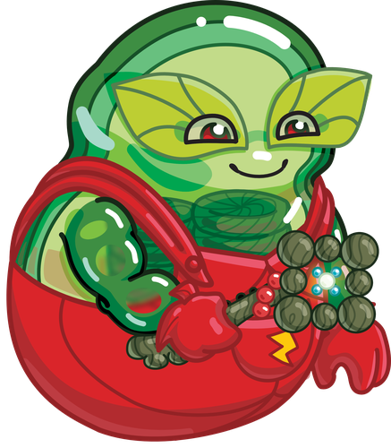

# Adapt and contribute

The workshop is designed to be **adapted**: to your audience, to your
curriculum, or to your own research. All the files are open: modify them,
add to them, invent your own cards!

{ .hero-image .petite }

## Making your own cards

**Blank templates** are available for each deck (stresses, consequences,
responses of the cell), front and back. They are also the way to make the
cards in another language.

[:material-download: Blank cards](https://github.com/cecile-lecampion/VCCV/tree/main/Carte/cartes_vierges){ .md-button .md-button--primary }

The characters are also available to illustrate your creations:
[Super Chloro](https://github.com/cecile-lecampion/VCCV/tree/main/Super_Chloroplaste)
and [the monsters and symbols](https://github.com/cecile-lecampion/VCCV/tree/main/Autres_acteurs).

## Modifying the 3D models

The 3D files are provided in **STL** and **OBJ** formats, which most
modelling software can open.

<!-- Specify here the software used for the design (the Accessoires
     folder contains a Fusion 360 .f3d file). -->

## Sharing your adaptations

Have you made new cards, adapted the activity for a class, or designed a new
piece? We would love to hear about it!
[Drop us a line](credits.md#get-in-touch).
