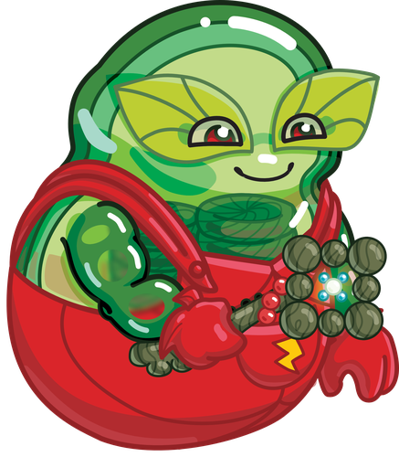

# Adapter et contribuer

L'atelier est conçu pour être **adapté** : à votre public, à votre programme,
ou à vos propres recherches. Tous les fichiers sont libres : modifiez-les,
complétez-les, inventez vos propres cartes !

{ .hero-image .petite }

## Créer vos propres cartes

Des **modèles vierges** sont disponibles pour chaque paquet (stress,
conséquences, réponses de la cellule), recto et verso.

[:material-download: Cartes vierges](https://github.com/cecile-lecampion/VCCV/tree/main/Carte/cartes_vierges){ .md-button .md-button--primary }

Les personnages sont aussi disponibles pour illustrer vos créations :
[Super Chloro](https://github.com/cecile-lecampion/VCCV/tree/main/Super_Chloroplaste)
et [les monstres et symboles](https://github.com/cecile-lecampion/VCCV/tree/main/Autres_acteurs).

## Modifier les modèles 3D

Les fichiers 3D sont fournis aux formats **STL** et **OBJ**, que la plupart
des logiciels de modélisation savent ouvrir.

<!-- Précisez ici le logiciel utilisé pour la conception (le dossier
     Accessoires contient un fichier Fusion 360 .f3d). -->

## Partager vos adaptations

Vous avez créé de nouvelles cartes, adapté le déroulé pour une classe,
imaginé une nouvelle pièce ? Nous serions ravis de le savoir !
[Laissez-nous un petit mot](credits.md#nous-contacter).
