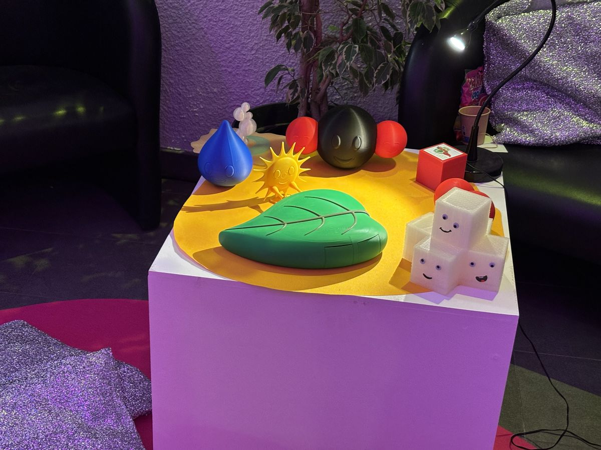

# Phase 2 – Plongée dans le chloroplaste

Cette phase repose entièrement sur les éléments imprimés en 3D. C'est **la
plus interactive** de l'atelier : chaque participant est invité à venir
manipuler !

**Matériel :** le chloroplaste, les thylakoïdes, la chaîne photosynthétique,
la boîte du cycle de Calvin, **des billes et des bonbons**
([voir le matériel](../materiel.md)).

## Le déroulé

1. **Le chloroplaste** s'ouvre sur les **thylakoïdes** empilés : le véritable
   lieu de la photosynthèse.
2. On zoome sur un morceau de membrane, couvert d'une myriade de petits
   complexes… dont certains sont verts.
3. Dernier zoom : **la chaîne photosynthétique**, avec ses complexes alignés
   sur la membrane dans l'ordre de la réaction, associée à la boîte du
   **cycle de Calvin**, qui fabrique les sucres.

## La séquence à expliquer au moins une fois

!!! note "1. L'eau est cassée grâce à la lumière"
    Au **photosystème II**, l'énergie lumineuse arrache des électrons à
    l'eau. L'oxygène est libéré (c'est l'O~2~ que nous respirons) et il
    reste des H^+^.

!!! note "2. Les électrons voyagent"
    Les électrons (**les billes** !) passent de complexe en complexe le long
    de la goulotte, jusqu'au **photosystème I**, puis au cycle de Calvin.

!!! note "3. Les H^+^ font tourner la turbine"
    En retraversant la membrane par l'**ATP synthase**, les H^+^ font
    tourner sa « tête » comme un moulin : elle fabrique de l'énergie (l'ATP)
    pour le cycle de Calvin.

!!! note "4. Le sucre est fabriqué"
    Grâce aux électrons et à l'ATP, les enzymes du **cycle de Calvin**
    attrapent le CO~2~ de l'air et produisent du sucre (**les bonbons** !).

Ensuite, laissez les participants faire fonctionner la chaîne à leur guise.
Attention : **pas d'électron… pas de bonbon !**

!!! tip "Retour d'expérience"
    À partir du cours moyen, les élèves comprennent déjà assez bien le
    transport d'électrons, et adorent cette partie !

## La version pour les plus petits

{ width="50" align=left }

Pour les plus jeunes (CP, CE1), le détail de la chaîne est trop complexe.
Remplacez cette phase par le **modèle simplifié** : une grande feuille à
laquelle on apporte l'eau, le CO~2~ et la lumière du soleil, et qui produit
le sucre et l'oxygène.

eau + CO2 + lumière → sucre + O2

Les grands formats de l'eau, du CO~2~, du sucre et de l'O~2~ servent de
réservoirs et sont faciles à manipuler par les enfants.

{ width="600" }

[:material-book-open-variant: Tout savoir : « La science derrière » dans le guide](../fascicule.md){ .md-button }
[:octicons-arrow-right-24: Phase 3 : les cartes](../cartes.md){ .md-button }
