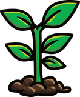
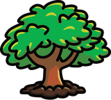

# Animer l'atelier

L'atelier est conçu en **trois phases**, que l'on peut enchaîner ou utiliser
séparément. Dans son format complet, il dure **de vingt minutes** (stand grand
public) **à une demi-journée** (classe). Face à une contrainte de temps ou de
place, n'hésitez pas à retirer des éléments ou à ne présenter qu'une partie !

-   :material-leaf:{ .lg .middle } **1. Découverte de la cellule végétale**

    ---

    La boîte-feuille, le modèle de cellule et, si possible, une observation
    au microscope.

    [:octicons-arrow-right-24: Voir la phase 1](cellule.md)

-   :material-magnify-plus:{ .lg .middle } **2. Plongée dans le chloroplaste**

    ---

    Jusqu'à la chaîne photosynthétique, la partie la plus interactive de
    l'atelier. Avec une version simplifiée pour les plus petits.

    [:octicons-arrow-right-24: Voir la phase 2](chloroplaste.md)

-   :material-cards:{ .lg .middle } **3. Les cartes**

    ---

    Que se passe-t-il quand l'environnement change ? Un stress, ses
    conséquences, les réponses de la cellule.

    [:octicons-arrow-right-24: Voir la phase 3](../cartes.md)

## Adapter le contenu à son public

Dans ce site et dans le guide de l'animateur, trois logos
indiquent le contenu que nous recommandons selon le public :

| | Public | Exemples |
|:---:|---|---|
| { width="50" } | **Les plus petits** | CP, CE1 |
| { width="50" } | **Les ados** | à partir du CM, collège, lycée |
| { width="50" } | **Les adultes** | grand public, visites de laboratoire |

Ce sont des recommandations issues de notre expérience : vous êtes libres de
les adapter à votre public et à votre sensibilité.

## Avant de commencer

- [ ] Les éléments 3D sont imprimés et montés ([voir le matériel](../materiel.md))
- [ ] J'ai des billes… et des bonbons !
- [ ] Les cartes sont imprimées ([voir les cartes](../cartes.md))
- [ ] J'ai parcouru le [guide de l'animateur](../fascicule.md)

!!! tip "Pas besoin d'être spécialiste"
    Le [guide de l'animateur](../fascicule.md) contient une partie
    « La science derrière » qui explique tout ce qu'il faut savoir, ainsi
    qu'une FAQ où Super Chloro répond aux questions les plus fréquentes.
