# The cards

Has everyone understood how photosynthesis works when all is well? Great!
Now it's time to talk about what happens **when things go wrong**.

## Three decks of cards

<figure markdown>
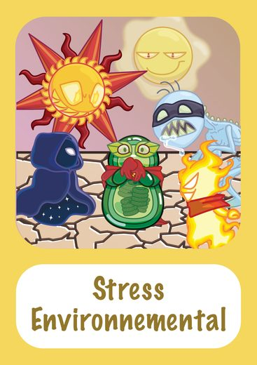
<figcaption><strong>Environmental</strong> stresses</figcaption>
</figure>

<figure markdown>
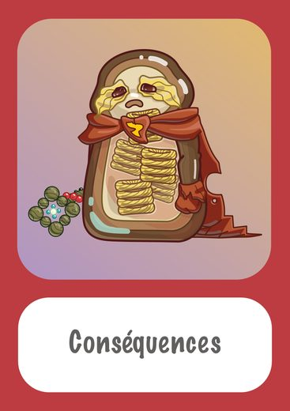
<figcaption><strong>Consequences</strong> for the plant</figcaption>
</figure>

<figure markdown>
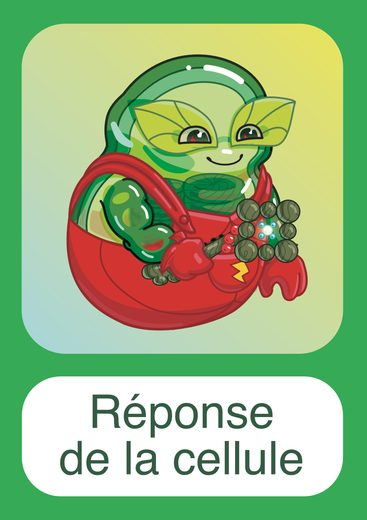
<figcaption><strong>Responses</strong> of the cell</figcaption>
</figure>

## How to play

1. Participants **draw an environmental stress** card.
2. They **guess the possible consequences** for the plant.
3. They look for **how the cell can respond** to the problem.

The aim is to make the discussion as interactive as possible.

=== "Small group"

    With small cards, the "consequences" and "responses" cards can be laid
    out on the table in front of the photosynthetic chain: participants can
    see them all and choose easily.

=== "Large group"

    Use large-format cards, or project them on the board. For an adult
    audience with smartphones, an interactive online quiz works very well.

The cards are the same for everyone: it is **the discussion that adapts to
the audience**. With younger children, keep to simple ideas ("the plant is
too hot, it closes its little mouths"); with older participants, you can go
into the details of the photosynthetic chain.

!!! note "The cards are in French"
    For now, the cards only exist in French. The blank templates let you
    make your own versions in other languages
    ([see Adapt and contribute](adapter.md)).

## The stresses… and their monsters

<figure markdown>
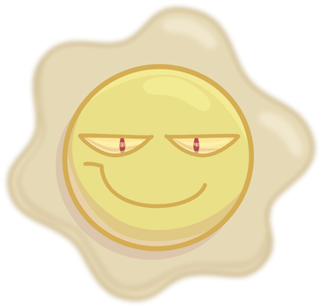
<figcaption>Low light</figcaption>
</figure>

<figure markdown>
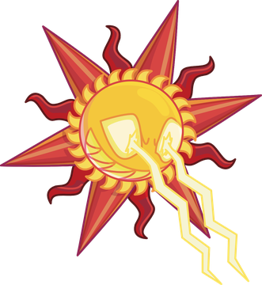
<figcaption>High light</figcaption>
</figure>

<figure markdown>
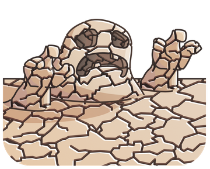
<figcaption>Drought</figcaption>
</figure>

<figure markdown>
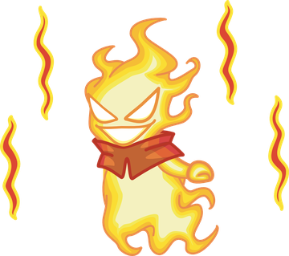
<figcaption>Heat</figcaption>
</figure>

<figure markdown>
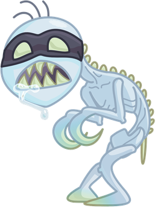
<figcaption>Nitrogen deficiency</figcaption>
</figure>

<figure markdown>

<figcaption>Darkness</figcaption>
</figure>

## A few example cards

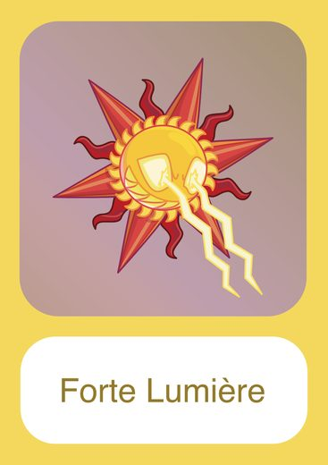
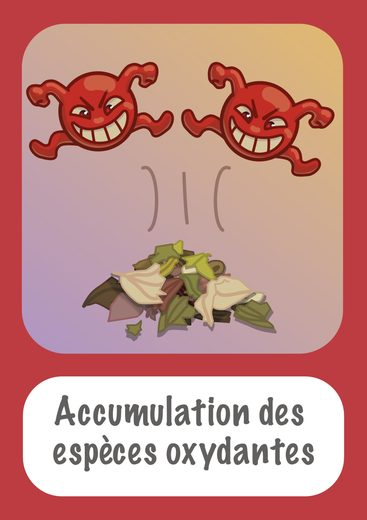
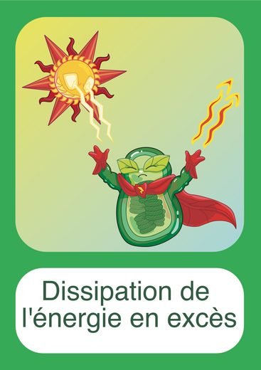

??? example "Example: high light"
    **Consequences:** the plant cannot stop absorbing light. Too many
    electrons flow through the chain: it becomes saturated (let some children
    play with the marbles – they will give you a superb demonstration!). The
    surplus electrons react with oxygen and form **reactive oxygen species**
    that damage the cell.

    **Responses of the cell:** dissipate the excess energy as heat, make
    antioxidants (carotenoids) and, if it lasts, reduce the size of the
    "antennae" that capture light.

The explanations for each stress are in the section "Let's play: what
happens when things go wrong?" of the [facilitator's guide](fascicule.md).

## Downloading the cards

[:material-download: The cards](https://github.com/cecile-lecampion/VCCV/tree/main/Carte){ .md-button .md-button--primary }
[:material-file-edit: Blank cards](https://github.com/cecile-lecampion/VCCV/tree/main/Carte/cartes_vierges){ .md-button }

!!! tip "Tip"
    Print the cards on thick paper and laminate them: they will last a very
    long time.
