# Les cartes

Tout le monde a compris comment fonctionne la photosynthèse quand tout va
bien ? Super ! Il est temps de discuter de ce qui se passe **quand tout va
mal**.

## Trois paquets de cartes

<figure markdown>
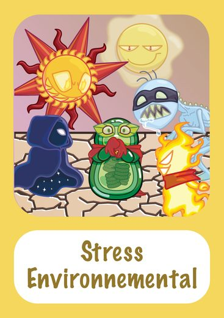
<figcaption><strong>Les stress</strong> environnementaux</figcaption>
</figure>

<figure markdown>
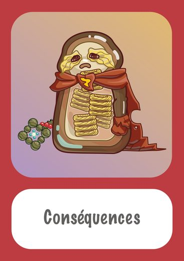
<figcaption><strong>Les conséquences</strong> pour la plante</figcaption>
</figure>

<figure markdown>
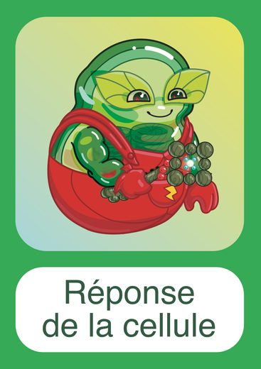
<figcaption><strong>Les réponses</strong> de la cellule</figcaption>
</figure>

## Comment jouer ?

1. Le public **pioche un stress** environnemental.
2. Il **devine les conséquences** possibles pour la plante.
3. Il cherche **comment la cellule peut répondre** au problème.

Le but est une discussion la plus interactive possible.

=== "Petit groupe"

    En petit format, les cartes « conséquences » et « réponses » peuvent être
    étalées sur la table devant la chaîne photosynthétique : le public les
    voit toutes et choisit facilement.

=== "Grand groupe"

    Utilisez des cartes en grand format, ou projetez-les au tableau. Pour un
    public adulte équipé de smartphones, un quiz participatif fonctionne
    très bien.

Les cartes sont les mêmes pour tous : c'est **la discussion qui s'adapte au
public**. Avec les plus jeunes, on reste sur des idées simples (« la plante a
trop chaud, elle ferme ses petites bouches ») ; avec les plus grands, on peut
entrer dans le détail de la chaîne photosynthétique.

## Les stress… et leurs monstres

<figure markdown>
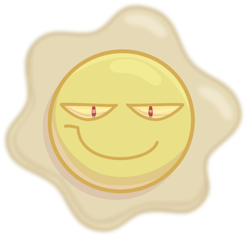
<figcaption>Faible lumière</figcaption>
</figure>

<figure markdown>
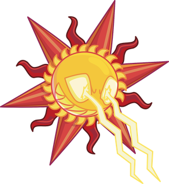
<figcaption>Forte lumière</figcaption>
</figure>

<figure markdown>
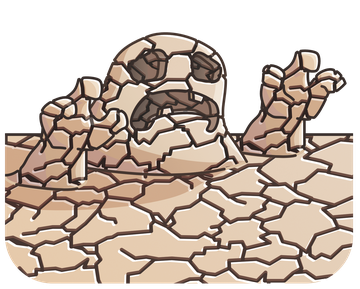
<figcaption>Sécheresse</figcaption>
</figure>

<figure markdown>
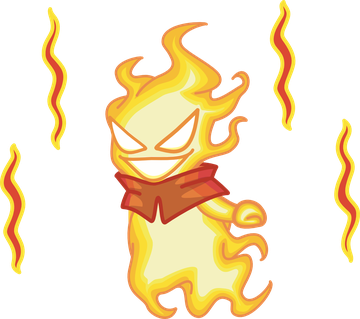
<figcaption>Chaleur</figcaption>
</figure>

<figure markdown>
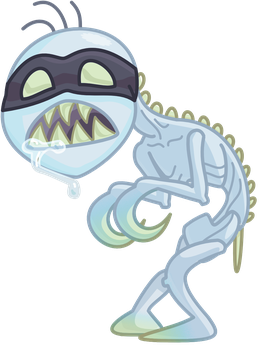
<figcaption>Carence en azote</figcaption>
</figure>

<figure markdown>

<figcaption>Obscurité</figcaption>
</figure>

## Quelques exemples de cartes

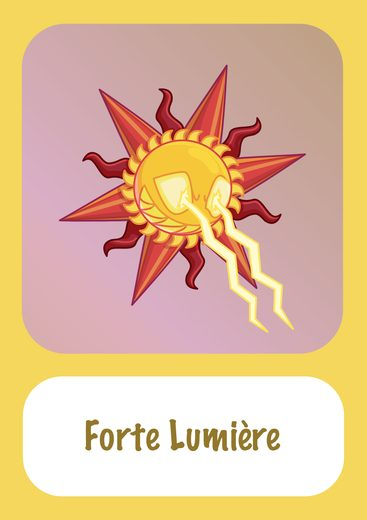
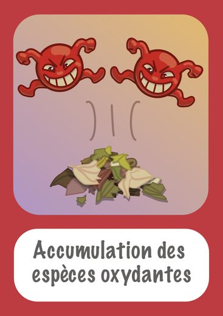
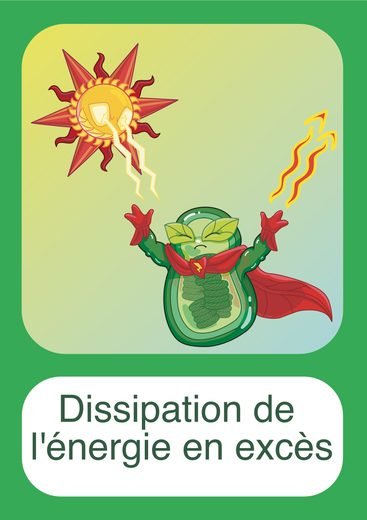

??? example "Exemple : la forte lumière"
    **Conséquences :** la plante ne peut pas arrêter d'absorber la lumière.
    Trop d'électrons circulent dans la chaîne : c'est la saturation (laissez
    des enfants jouer avec les billes, ils vous en feront une superbe
    démonstration !). Les électrons en trop réagissent avec l'oxygène et
    forment des **espèces oxydantes** qui abîment la cellule.

    **Réponses de la cellule :** dissiper l'énergie en excès sous forme de
    chaleur, fabriquer des antioxydants (les caroténoïdes), et si ça dure,
    réduire la taille des « antennes » qui captent la lumière.

Les explications pour chaque stress sont dans la partie « Jouons un peu : que
se passe-t-il quand ça va mal ? » du [guide de l'animateur](fascicule.md).

## Télécharger les cartes

[:material-download: Les cartes](https://github.com/cecile-lecampion/VCCV/tree/main/Carte){ .md-button .md-button--primary }
[:material-file-edit: Cartes vierges](https://github.com/cecile-lecampion/VCCV/tree/main/Carte/cartes_vierges){ .md-button }

!!! tip "Conseil"
    Imprimez les cartes sur papier épais et plastifiez-les : elles
    serviront très longtemps.
