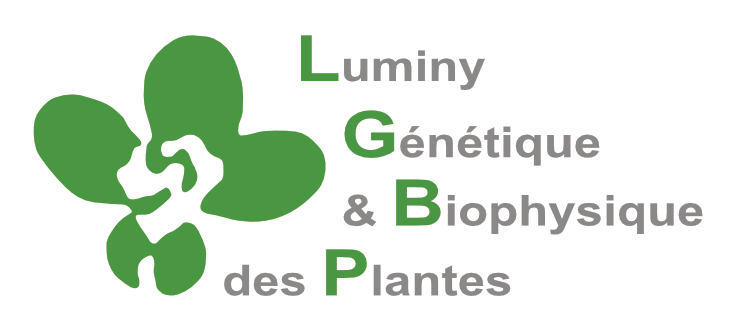
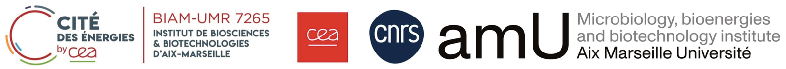
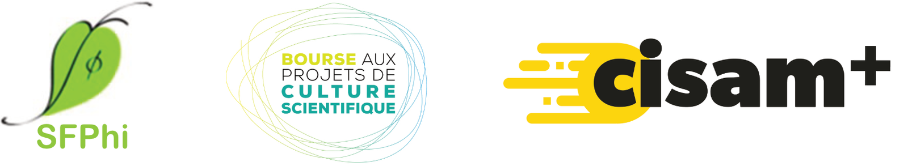

# About us

*Journey to the Heart of the Plant Cell* (*Voyage au cœur de la cellule
végétale*) grew out of a wish to share our favourite subject of study, and
its wonders, with as wide an audience as possible. It was developed within
the **Luminy Plant Genetics and Biophysics** team (BIAM/LGBP) in Marseille,
France.

{ width="220" }

## The team

-   **Cécile Lecampion**

    Engineer, Aix-Marseille University

-   **Pascaline Auroy**

    Engineer, CEA

-   **Aurélie Crepin**

    Associate Professor, Aix-Marseille University

## Illustrations

Super Chloro, the monsters and all the card illustrations were created by
**Vik Lygaïsun**.

[:material-instagram: Discover their work](https://www.instagram.com/p/DdHcsbZkYL1/){ .md-button }

## Acknowledgements

- The marbles for the electrons and the sweets for the sugar were inspired
  by a fantastic photosynthesis model designed and developed by
  **Grzegorz Konert** (University of Turku, Finland).
- Many thanks to **Benoît Menand** and **Alexandra Maraval** for their help
  in setting up and developing the project, and to the whole **LGBP (BIAM)**
  team for their support and feedback!
- Thanks to **Michel Térèse** for his active contribution to the 3D design.

## Support

*Journey to the Heart of the Plant Cell* is funded by a project grant from
the **Science Outreach Unit of Aix-Marseille University** (Cellule de Culture
Scientifique). We are partners of the **French Society of Photosynthesis**
(Société Française de Photosynthèse) and of **CISAM+**.

{ width="420" }

## Get in touch

Are you using the model? Please let us know, send us your feedback, or even
your photos!

[:material-message-text: Drop us a line](https://github.com/cecile-lecampion/VCCV/discussions/1){ .md-button .md-button--primary }

## Licence

The project files are distributed under the
[GNU AGPL v3](https://github.com/cecile-lecampion/VCCV/blob/main/LICENSE)
licence.

## Citing the workshop

<!-- Replace the items below with the actual references
     once the deposits are made (see MISE_EN_PLACE_SITE.md, section 7). -->

If you use this workshop, please cite it:

> Lecampion C., Auroy P., Crepin A. (*year*). *Voyage au cœur de la cellule
> végétale* (Journey to the Heart of the Plant Cell). HAL: *hal-XXXXXXXX*

??? info "Long-term archive of the source files"
    All the files (3D models, cards, website) are archived by Software
    Heritage: *SWHID to be added*.
