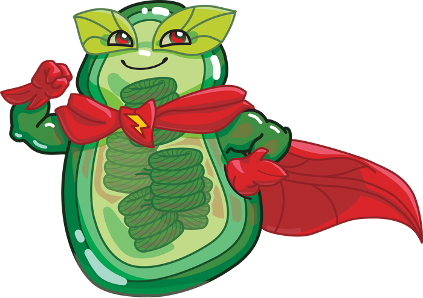

# The facilitator's guide

Written for future facilitators and other enthusiasts, the guide takes you
step by step through preparing and running the workshop, and provides all
the scientific background you need. **No need to be a specialist!**

[:material-file-pdf-box: Download the guide (PDF, in French)](https://github.com/cecile-lecampion/VCCV/raw/main/VCCV%20-%20Guide%20de%20l'Animateur%20beta2.pdf){ .md-button .md-button--primary }

!!! info "Working version"
    This version is not final: some sections are still incomplete. It should
    nevertheless be enough to get the impatient started! For any missing
    information, [get in touch](credits.md#get-in-touch).

!!! note "In French only for now"
    The guide is currently only available in French.

{ .hero-image }

## What you will find in it

-   :material-puzzle:{ .lg .middle } **What's in the kit**

    ---

    The pieces of the 3D model, how to assemble them, and the cards.

-   :material-human-male-board:{ .lg .middle } **How the workshop runs**

    ---

    The three phases, with tips depending on the audience and the venue.

-   :material-microscope:{ .lg .middle } **The science behind it**

    ---

    From the plant to the cell, the chloroplast and photosynthesis, and what
    happens with low or high light, drought, heat or nitrogen deficiency.

-   :material-chat-question:{ .lg .middle } **FAQ: Super Chloro answers you**

    ---

    Why are plants green? Do plants benefit from rising CO~2~ levels? How
    do desert plants cope?…

## Meet Super Chloro

In a quiet leaf of a tall plane tree lived a little chloroplast called
Chloro. One particularly bright morning, he took a closer look at what he
did without thinking: he captured carbon dioxide, absorbed water and, thanks
to light, turned it all into sugars.

*"But… I'm making matter! I'm turning air and light into useful energy!"*

Amazed, Chloro realised he had a real superpower. With a mask to protect his
eyes from the intense rays and a red cape flowing in the wind, he became
**Super Chloro**, with a mission: to explain the secret of photosynthesis to
everyone. *"Without us, there's no food, no oxygen, no life!"*
