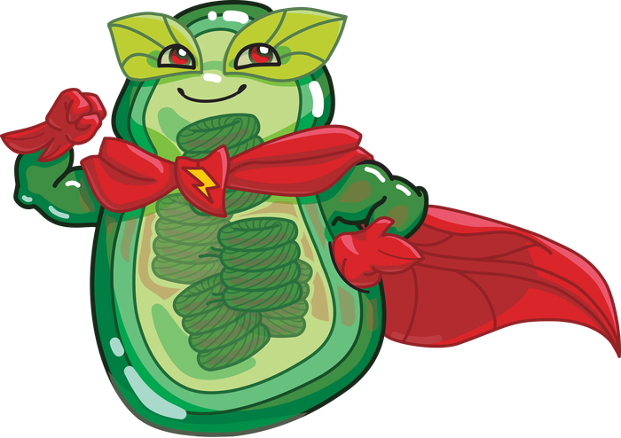

# Le guide de l'animateur

Destiné aux futurs animateurs et autres passionnés, le guide accompagne
pas à pas la préparation et l'animation de l'atelier, et donne toutes les
connaissances scientifiques nécessaires. **Pas besoin d'être spécialiste !**

[:material-file-pdf-box: Télécharger le guide (PDF)](https://github.com/cecile-lecampion/VCCV/raw/main/VCCV%20-%20Guide%20de%20l'Animateur%20beta2.pdf){ .md-button .md-button--primary }

!!! info "Version de travail"
    Cette version n'est pas définitive : certaines sections sont encore
    incomplètes. Elle devrait cependant suffire comme point de départ pour
    les impatients ! Pour toute information manquante,
    [contactez-nous](credits.md#nous-contacter).

{ .hero-image }

## Ce que vous y trouverez

-   :material-puzzle:{ .lg .middle } **La composition du set**

    ---

    Les éléments du modèle 3D, le montage et les cartes.

-   :material-human-male-board:{ .lg .middle } **Le déroulement de l'atelier**

    ---

    Les trois phases, avec des conseils selon le public et le lieu.

-   :material-microscope:{ .lg .middle } **La science derrière**

    ---

    De la plante à la cellule, le chloroplaste et la photosynthèse, et ce
    qui se passe en cas de faible ou forte lumière, sécheresse, chaleur ou
    carence en azote.

-   :material-chat-question:{ .lg .middle } **FAQ : Super Chloro vous répond**

    ---

    Pourquoi les plantes sont-elles vertes ? Les plantes profitent-elles de
    l'augmentation du CO~2~ ? Comment font les plantes du désert ?…

## Faites connaissance avec Super Chloro

Dans une feuille tranquille d'un grand platane vivait un petit chloroplaste
nommé Chloro. Un matin particulièrement lumineux, il observa de plus près ce
qu'il faisait sans y penser : il captait du dioxyde de carbone, absorbait de
l'eau, et grâce à la lumière, transformait tout cela en sucres.

*« Mais… je fabrique de la matière ! Je transforme l'air et la lumière en
énergie utile ! »*

Émerveillé, Chloro comprit qu'il possédait un véritable super pouvoir. Avec un
masque pour protéger ses yeux des rayons intenses et une cape rouge flottant
au vent, il devint **Super Chloro**, avec une mission : expliquer à tous le
secret de la photosynthèse. *« Sans nous, pas de nourriture, pas d'oxygène,
pas de vie ! »*
