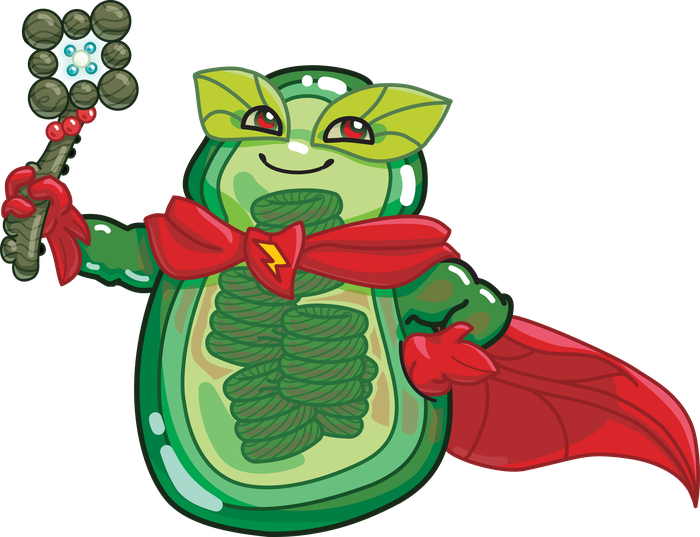
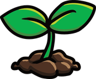
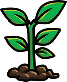
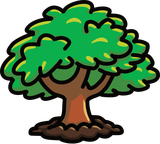
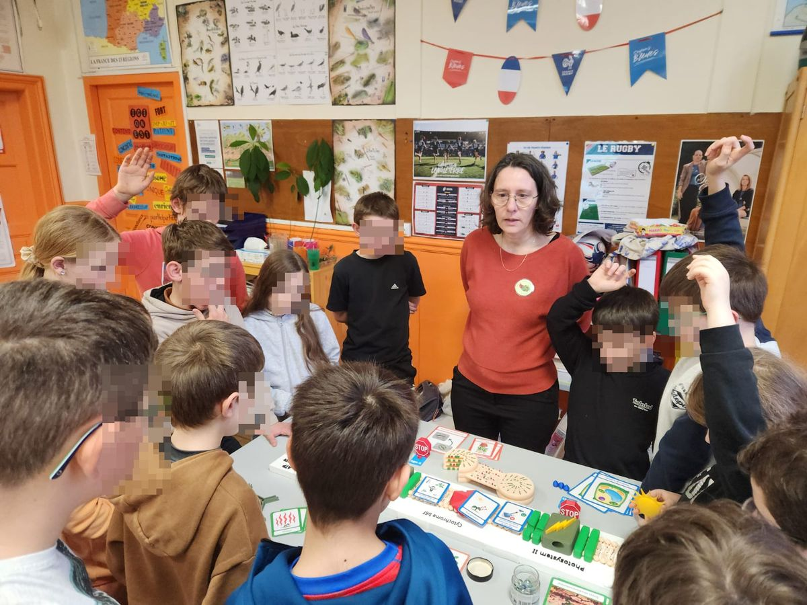
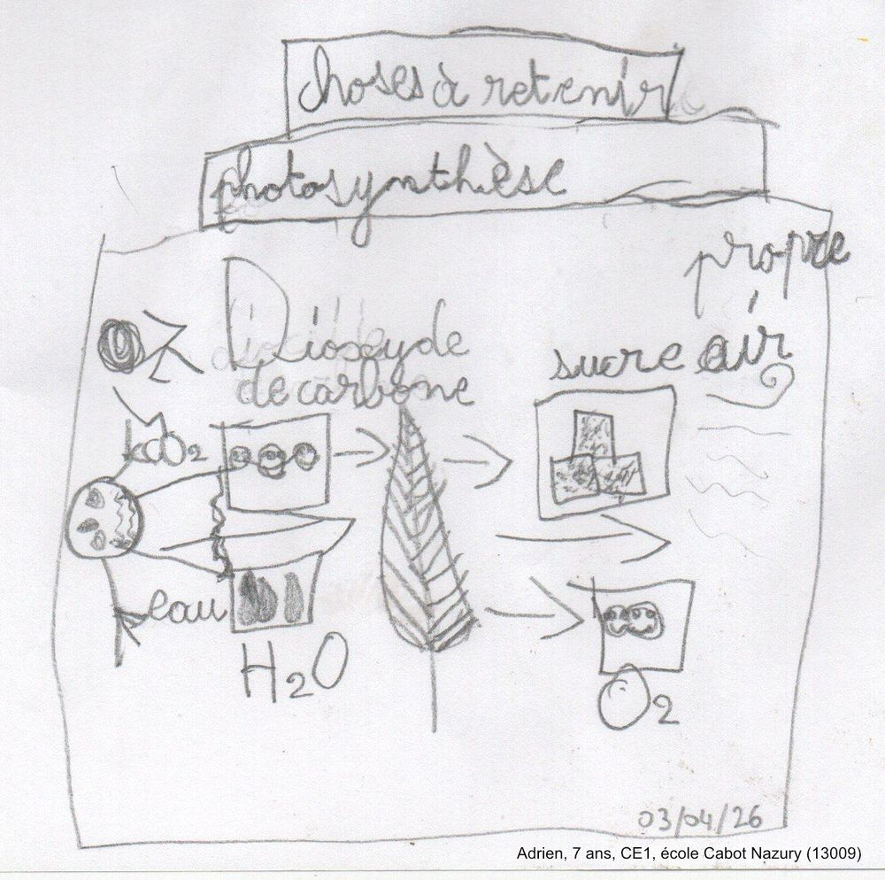

---
hide:
  - navigation
  - toc
---

# Journey to the Heart of the Plant Cell

A **science outreach kit** for travelling from an object everyone knows,
**the leaf**, all the way to the heart of **photosynthesis**: the process
that produces the oxygen we breathe and the sugars all living things need.

**3D-printed models** to assemble, take apart and handle, a **card game** to
think about how plants respond to environmental stress, and a **guide for
facilitators**. Everything is **free and open**.

[:material-printer-3d: The kit](materiel.md){ .md-button .md-button--primary }
[:material-human-male-board: Running the workshop](animer/index.md){ .md-button }

{ .hero-image }

---

## Zooming in from the leaf to the photosynthetic chain

The workshop unfolds like a journey into the infinitely small. At each step,
participants can **see, handle and operate** the structures of the cell to
understand how they work – and, ideally, have fun doing it!

-   :material-leaf:{ .lg .middle } **1. The leaf and the cell**

    ---

    From the potted plant to the plant cell, with a look through the
    microscope if you have one.

    [:octicons-arrow-right-24: Discover the cell](animer/cellule.md)

-   :material-magnify-plus:{ .lg .middle } **2. Diving into the chloroplast**

    ---

    From the thylakoids to the photosynthetic chain: marbles for the
    electrons… and sweets for the sugar!

    [:octicons-arrow-right-24: Dive into the chloroplast](animer/chloroplaste.md)

-   :material-cards:{ .lg .middle } **3. When things go wrong: the cards**

    ---

    Heat, drought, too much or too little light: how does the plant
    respond?

    [:octicons-arrow-right-24: Play with the cards](cartes.md)

## For all audiences

The workshop is **modular**: it fits a festival stand as well as a classroom
session, **from twenty minutes to half a day**. Three logos help you choose
the right content:

<figure markdown>

<figcaption>For young children</figcaption>
</figure>

<figure markdown>

<figcaption>For teenagers</figcaption>
</figure>

<figure markdown>

<figcaption>For adults</figcaption>
</figure>

## They have already made the journey

[:material-image-multiple: See the gallery](galerie.md){ .md-button }

!!! info "A work in progress"
    Some 3D models, including the thylakoids and the photosynthetic chain,
    will be available soon. Come back and see us!

---

<small>
Developed by the Luminy Plant Genetics and Biophysics team
(BIAM/LGBP, Marseille, France) with the support of the Science Outreach
Unit of Aix-Marseille University. [About us](credits.md)
</small>
