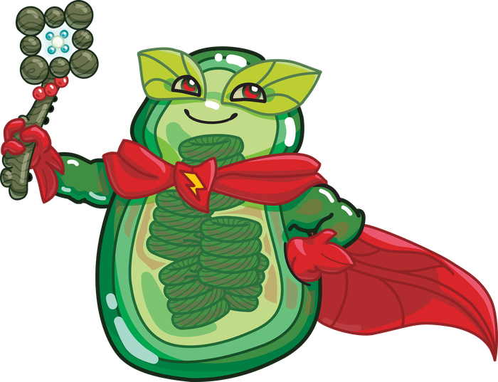
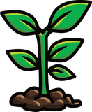
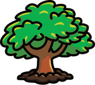
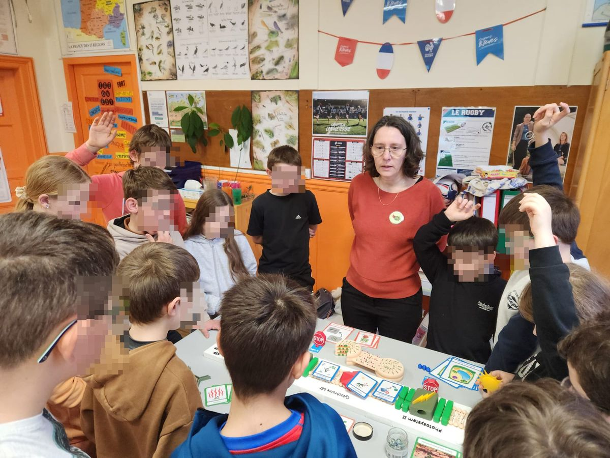
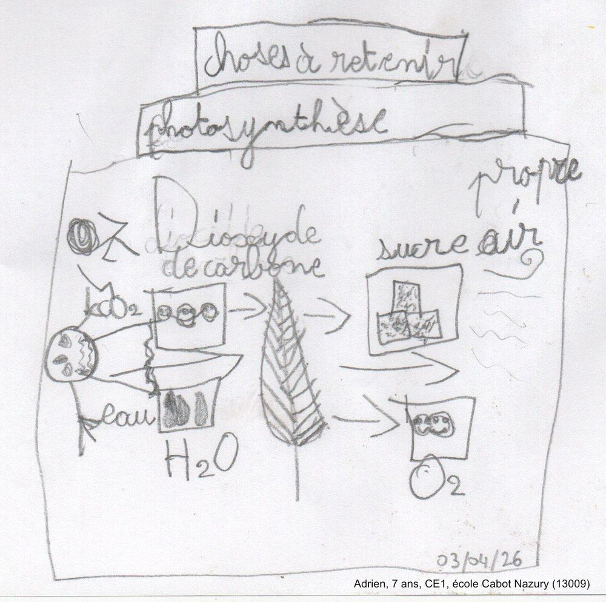

---
hide:
  - navigation
  - toc
---

# Voyage au cœur de la cellule végétale

Un **set de vulgarisation** pour voyager depuis un objet que tout le monde
connaît, **la feuille**, jusqu'au cœur de **la photosynthèse** : le processus
qui produit l'oxygène que nous respirons et les sucres dont tout le vivant
a besoin.

Des **modèles imprimés en 3D** à monter, démonter et manipuler, un **jeu de
cartes** pour réfléchir aux réponses de la plante face aux stress
environnementaux, et un **guide pour les animateurs**. Le tout est **libre et
gratuit**.

[:material-printer-3d: Le matériel](materiel.md){ .md-button .md-button--primary }
[:material-human-male-board: Animer l'atelier](animer/index.md){ .md-button }

{ .hero-image }

---

## Un zoom de la feuille jusqu'à la chaîne photosynthétique

L'atelier se déroule comme un voyage vers l'infiniment petit. À chaque étape,
le public peut **voir, manipuler et actionner** les structures de la cellule
pour comprendre leur fonctionnement – et si possible en s'amusant !

-   :material-leaf:{ .lg .middle } **1. La feuille et la cellule**

    ---

    De la plante en pot à la cellule végétale, avec une observation au
    microscope si vous en avez un.

    [:octicons-arrow-right-24: Découvrir la cellule](animer/cellule.md)

-   :material-magnify-plus:{ .lg .middle } **2. Plongée dans le chloroplaste**

    ---

    Des thylakoïdes jusqu'à la chaîne photosynthétique : des billes pour les
    électrons… et des bonbons pour le sucre !

    [:octicons-arrow-right-24: Plonger dans le chloroplaste](animer/chloroplaste.md)

-   :material-cards:{ .lg .middle } **3. Quand ça va mal : les cartes**

    ---

    Chaleur, sécheresse, trop ou pas assez de lumière : comment la plante
    réagit-elle ?

    [:octicons-arrow-right-24: Jouer avec les cartes](cartes.md)

## Pour tous les publics

L'atelier est **modulaire** : il s'adapte à un stand de festival comme à une
intervention en classe, **de vingt minutes à une demi-journée**. Trois logos
vous aident à choisir le contenu adapté :

<figure markdown>

<figcaption>Pour les plus petits</figcaption>
</figure>

<figure markdown>

<figcaption>Pour les ados</figcaption>
</figure>

<figure markdown>

<figcaption>Pour les adultes</figcaption>
</figure>

## Ils ont déjà fait le voyage

[:material-image-multiple: Voir la galerie](galerie.md){ .md-button }

!!! info "Un projet en cours de construction"
    Certains modèles 3D, notamment ceux des thylakoïdes et de la chaîne
    photosynthétique, seront bientôt disponibles. Revenez nous voir !

---

<small>
Développé par l'équipe Luminy Génétique et Biophysique des Plantes
(BIAM/LGBP, Marseille) avec le soutien de la Cellule de Culture Scientifique
d'Aix-Marseille Université. [Qui sommes-nous ?](credits.md)
</small>
