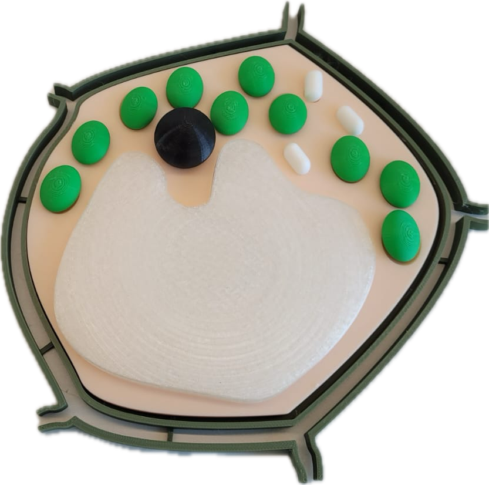
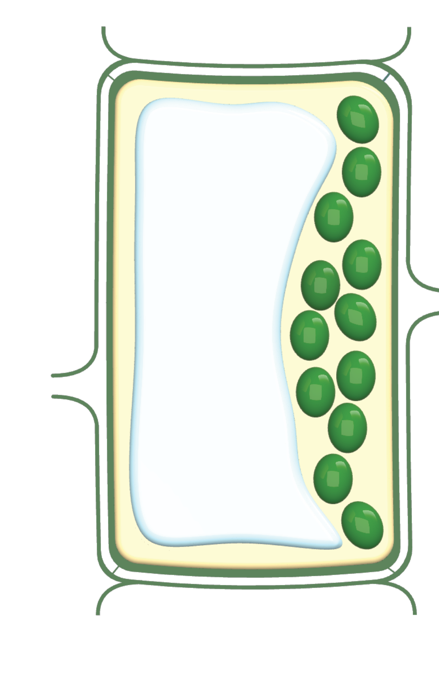
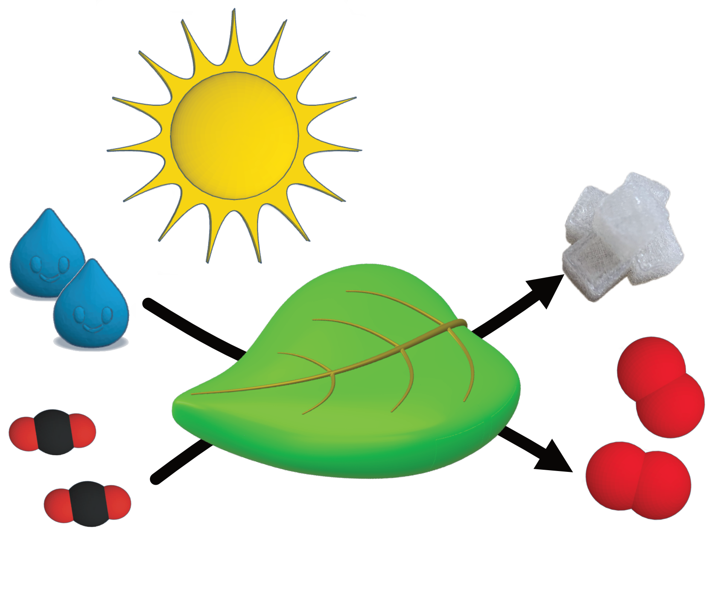
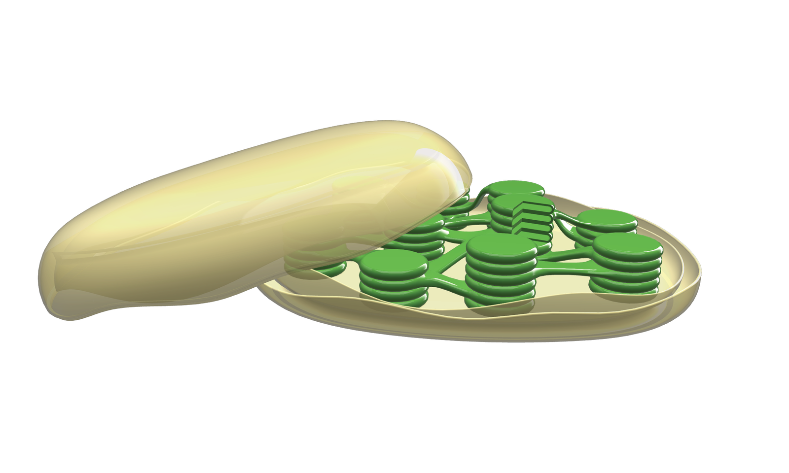
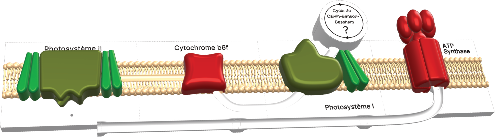
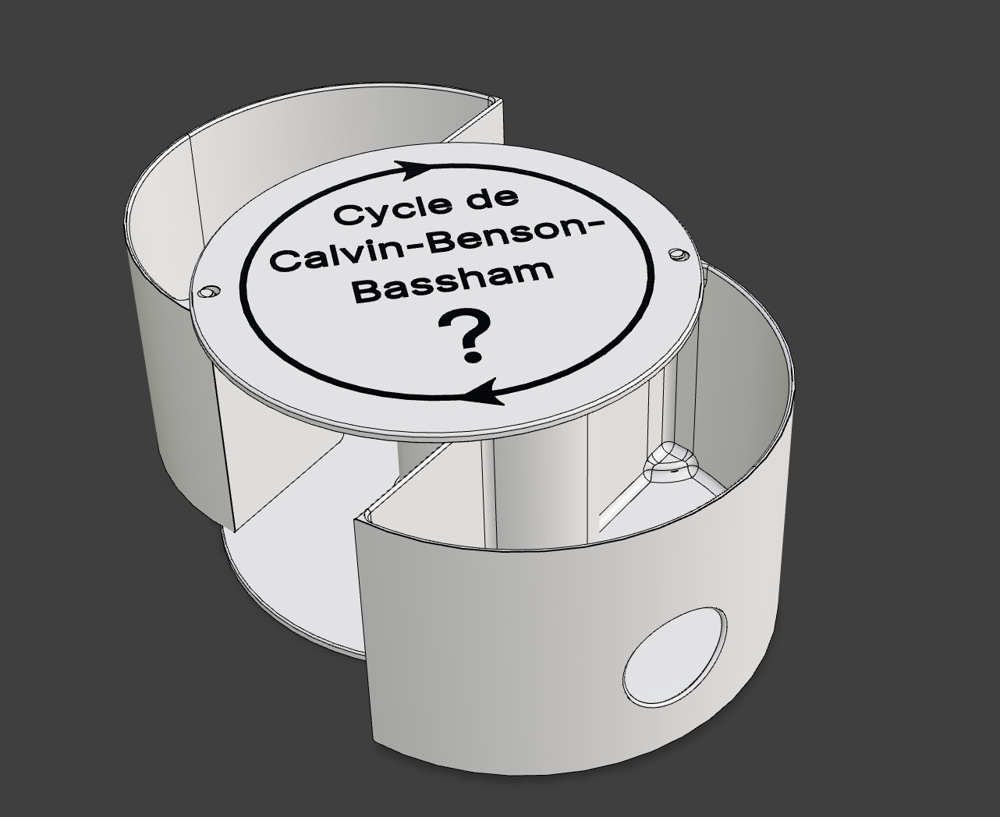

# The kit

The kit is made of **3D-printed** pieces that can be assembled, taken apart,
combined or used on their own. They follow the workshop's zoom, from the
whole plant down to the photosynthetic chain.

!!! warning "Models being finalised"
    Some pieces are still evolving and others are coming soon (thylakoids,
    electron transport chain). The latest files are always in the folders
    listed below.

## The pieces, step by step

-   :material-flower:{ .lg .middle } **The leaf box**

    ---

    An *Arabidopsis thaliana* rosette in its pot, which opens like a box
    onto panels describing the structure of the leaf. The panel visuals are
    printed on card and glued on.

    [:octicons-file-directory-24: 3D files](https://github.com/cecile-lecampion/VCCV/tree/main/Modele_3D/Boite_feuille)

-   :material-hexagon-multiple-outline:{ .lg .middle } **The plant cell**

    ---

    { .illustration-demi }
    { .illustration-demi }

    Two versions: a detailed cell, in which each compartment (nucleus,
    vacuole, mitochondria, chloroplast) can be handled separately, and a
    cell "as seen under the microscope", ideal for young children.

    [:octicons-file-directory-24: 3D files](https://github.com/cecile-lecampion/VCCV/tree/main/Modele_3D/Plant_cell)

-   :material-sun-thermometer:{ .lg .middle } **Photosynthesis for young children**

    ---

    { .illustration }

    A large leaf that receives water, CO~2~ and sunlight, and produces
    sugar and oxygen.

    [:octicons-file-directory-24: 3D files](https://github.com/cecile-lecampion/VCCV/tree/main/Modele_3D/Photosynth%C3%A8se_petits)

-   :material-pill:{ .lg .middle } **The chloroplast**

    ---

    { .illustration }

    A base, a lid… and the stacked thylakoids inside.

    [:octicons-file-directory-24: 3D files](https://github.com/cecile-lecampion/VCCV/tree/main/Modele_3D/Chloroplaste)

-   :material-transit-connection-variant:{ .lg .middle } **The photosynthetic chain**

    ---

    { .illustration }

    The complexes lined up on their membrane, and a chute along which the
    electrons travel.

    *Coming soon.*

-   :material-sync:{ .lg .middle } **The Calvin-Benson-Bassham cycle**

    ---

    { .illustration }

    A box with two drawers: one receives the marbles (the electrons) coming
    from the chain, the other holds the sweets (the sugar) that come out!

    [:octicons-file-directory-24: 3D files](https://github.com/cecile-lecampion/VCCV/tree/main/Modele_3D/cycle%20Calvin)

A few accessories complete the kit:
[:octicons-file-directory-24: Accessories](https://github.com/cecile-lecampion/VCCV/tree/main/Modele_3D/Accessoires).

## What you need besides the printed pieces

- **marbles**, which represent the electrons;
- **sweets**, which represent the sugar produced (no electrons… no sweets!);
- if possible, a school **microscope** to look at a leaf;
- the [cards](cartes.md), printed on thick paper.

## Downloading the files

Each "3D files" button above opens the corresponding folder. Click on a file,
then on the :material-download: icon ("Download raw file") at the top right
to save it.

You can also download **the whole project at once** (models, cards, guide,
photos):

[:material-download: Download everything (zip)](https://github.com/cecile-lecampion/VCCV/archive/refs/heads/main.zip){ .md-button }

??? question "I don't have a 3D printer. What can I do?"
    Many places offer open access to 3D printers: fablabs and makerspaces,
    libraries, schools, universities… Just bring the downloaded files.

## Printing and assembly

<!-- To be completed once the models are final: list of pieces,
     suggested colours, print settings, assembly steps. -->

*Printing tips and detailed assembly instructions will be added once the
models are finalised.*

??? question "There is no hook for the water and oxygen labels on photosystem II. What should I do?"
    Small hooks printed in PLA are too fragile to bear the weight and
    handling of the labels. Instead, we made a hole in which we glue a small
    nail or, even better, a shelf support peg like those used in flat-pack
    furniture (there are often spare ones). We will update the models as
    soon as we find a better solution!
